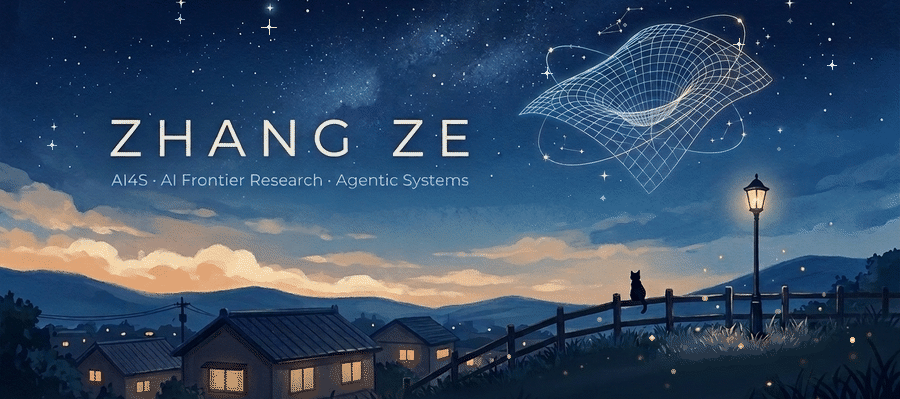

  <!-- Studio Ghibli 星空暮光动态 Hero Banner（含流星、萤火虫与暖光街灯；如需静态超清版可换 ./assets/banner.png） -->
  

   

  <!-- 自托管打字机动画 SVG（零第三方宕机风险，深浅模式皆清晰） -->
  <!-- 如需改用在线版，可替换为：https://readme-typing-svg.herokuapp.com?font=Fira+Code&weight=500&size=18&height=38&color=7FB5E6&center=true&vCenter=true&width=640&lines=Hi+%F0%9F%91%8B+I%27m+Zhang+Ze;Focusing+on+AI4S+%26+AI+Frontier+Research -->
  

  

    🧬 <b>AI4S &amp; AI Frontier Research</b> · 📍 Malaysia ·
    🪪 <a href="https://orcid.org/0009-0003-5959-3154">ORCID</a> ·
    📧 <a href="mailto:fuchanze@gmail.com">fuchanze@gmail.com</a>
  

  <!-- 紧凑社交链接条（GitHub 上自动水平并排显示） -->
  

    
    
    
    
  

---

### 🔬 Research & Engineering Focus

> **Geometric Diagnostics of Frontier LLMs**
> Investigating the internal geometry of large language model failure modes — exploring standpoint attractors, curvature, and holonomy structures ([Standpoint-Holonomy / LCESA](https://github.com/zhangze1007/Standpoint-Holonomy)) to map where, why, and how frontier models break down.
>
> **AI4S & Trustworthy BioDesign Governance**
> Designing verifiable safety boundaries and assumption-gated execution runtimes for AI-assisted scientific workflows ([Assumption-Gated BioDesign Runtime](https://github.com/zhangze1007/Assumption-Gated-Biodesign-Runtime-Artifact)), pairing policy DSLs with reproducible governance benchmarks.
>
> **Proactive & Defensive Agentic Systems**
> Building real-world AI agents & decision-support platforms that intervene before harm happens — spanning personal finance defense ([CtrlPay](https://github.com/zhangze1007/CtrlPay), [Smart-Nutty-Fi](https://github.com/zhangze1007/Smart-Nutty-Fi)) and climate/heat-risk intelligence systems.

---

### 🌱 Long-term Vision

> I aim to bridge frontier AI theory and real-world scientific & engineering reliability — turning geometric insights into verifiable safety runtimes, and turning research prototypes into resilient agentic systems that people can genuinely trust.

---

### 🚀 Featured Projects & Competitions

| Project | Focus / Event | Highlights |
| :--- | :---: | :--- |
| **[Standpoint-Holonomy](https://github.com/zhangze1007/Standpoint-Holonomy)** | `AI Frontier` · `Python` | *LCESA* — diagnostic framework analyzing the geometric structure of LLM failure modes. |
| **[Assumption-Gated BioDesign](https://github.com/zhangze1007/Assumption-Gated-Biodesign-Runtime-Artifact)** | `AI4S` · `TypeScript` | Public governance artifact: 74 biodesign cases, Policy DSL, gate evaluator & reproduction scripts. |
| **ThermoShield** *(Private)* | `Global Sustainability Challenge (GSC)` · `JS` | Construction heat-risk intelligence & decision support platform helping site supervisors monitor extreme heat hazards. |
| **Sigma IsoMorphX** *(Private)* | `UM Datathon 2026` · `Python` | Financial analytics & Power BI intelligence workflow built on synthetic SWIFT payment data with validated findings. |
| **[CtrlPay](https://github.com/zhangze1007/CtrlPay)** | `Agentic AI` · `TypeScript` | Proactive, defensive finance agent for uni students with impulse quarantine & tamper-evident audits. |
| **[Smart-Nutty-Fi](https://github.com/zhangze1007/Smart-Nutty-Fi)** | `AI Fintech` · `TypeScript` | Everyday money assistant combining natural language, risk intervention & cashflow simulation. |

---

### 👨‍💻 Languages & Tools

  <!-- 统计卡片配色呼应吉卜力星空蓝 (#101B33) + 星光蓝 (#7FB5E6) + 暖灯金 (#F0C674) -->
  <!-- 注：在 GitHub 主页 Contribution settings 勾选 "Include private contributions on my profile" 后，Streak 卡片即可自动计入 Private 仓库提交 -->
  
  

 

  <!-- 精简核心 7 项技术栈（可随时增删：https://skillicons.dev） -->
  

---

### ✨ Quote & Lab Vibe

  <!-- 致敬 Zach 的三柴犬蹦迪彩蛋（吉卜力柴犬研究员定制版，想只留 1 只删掉两行即可） -->
  
  
  
    
  <i>"What I cannot create, I do not understand." — Richard Feynman</i>

<!--
  🐍 可选彩蛋：贪吃蛇贡献图（推到 GitHub 并在 Actions 运行一次 "Generate Contribution Snake" 后取消注释）

 

  <picture>
    <source media="(prefers-color-scheme: dark)" srcset="https://raw.githubusercontent.com/zhangze1007/zhangze1007/output/github-contribution-grid-snake-dark.svg" />
    <source media="(prefers-color-scheme: light)" srcset="https://raw.githubusercontent.com/zhangze1007/zhangze1007/output/github-contribution-grid-snake.svg" />
    
  </picture>

-->

 

<!-- 星空靛蓝 → 暮光蓝 → 暖灯晚霞金渐变底边波浪 -->

  

